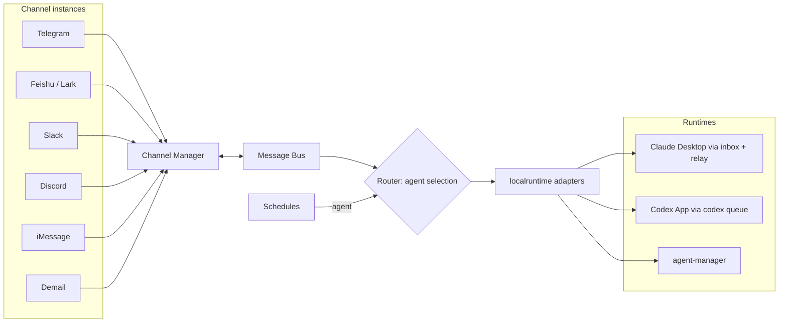

# FractalBot

[](https://opensource.org/licenses/MIT)
[](https://go.dev/)
[](https://github.com/fractalmind-labs/fractalmind-os/stargazers)

FractalBot is a local-first messaging gateway between people and agents. One gateway connects every chat channel and delivers each message, with its routing context, to the agent it is meant for. The agent can run in Claude Desktop, the Codex App or an agent-manager tmux session. FractalBot also wakes agents on schedules. It routes messages and does not process them. It runs on macOS, Linux and Windows.

## Capabilities

### Channels

| Channel | Inbound | Outbound | Transport and scope |
| --- | --- | --- | --- |
| Telegram | Yes | Yes | Long polling or webhook; DM-only and allowlisted. |
| Feishu / Lark | Yes | Yes | App credentials and user allowlist. |
| Slack | Yes | Yes | Socket Mode; DMs and configured channel mentions. |
| Discord | Yes | Yes | Gateway WebSocket; DM-only and allowlisted. |
| iMessage | Yes | Yes | macOS Messages database polling and AppleScript sending. |
| Demail | Transport only | Yes | Encrypted on-chain agent mail on Sui; generic Agent Router ingress is not yet enabled. |

### Agents and runtimes

Each agent is a workspace with one runtime and the channels it receives. A channel bound to one agent is dedicated to it. A channel bound to several agents is shared: a message goes to the agent it mentions, then to the agent its chat is pinned to, then to the conversation's `/use` choice, then to the channel's default. See [Routing](docs/routing.md).

| Runtime | Target | Delivery |
| --- | --- | --- |
| `claudeDesktop` | Claude Desktop | A durable per-agent inbox, moved into the session by `fractalbot relay` over Claude's authenticated messaging socket. |
| `codexApp` | Codex App | `codex queue` into the agent's pinned thread; Codex's queue holds the message until the thread is free. |
| `agentManager` | agent-manager (tmux) | `assign` to the agent-manager agent; can start a stopped agent and run its native heartbeat lifecycle. |

Secrets are never stored in the configuration. Values live in the OS credential store, owner-only files, environment variables or a password manager, and are masked in every log line.

## Architecture



The gateway wires channel instances, the buffered Message Bus, the router and the schedules. HTTP/CLI sends enter the outbound bus; normalized channel events enter the inbound bus. See [Architecture](docs/architecture.md) for component boundaries, message flows, and the current Demail ingress limitation.

## Quick start

Requires Go 1.23 or newer.

```bash
git clone https://github.com/fractalmind-labs/fractalmind-os.git
cd fractalmind-os/runtime/fractalbot
cp config.example.yaml config.yaml
```

A minimal `config.yaml`: one Telegram bot delivering to a Claude Desktop session, woken every hour.

```yaml
version: 2

# ── Channels: how to reach each chat platform ───────────────
channels:
  telegram:
    main:
      botToken: secret:telegram-main     # the value lives in this machine's keychain
      allowedUsers: [123456789]

# ── Agents: who receives messages and schedules ─────────────
agents:
  assistant:                    # a Claude Desktop session (its start hook runs `fractalbot relay`)
    workspace: ~/workspace/assistant
    runtime: claudeDesktop
    channels: [telegram.main]

# ── Schedules: when to wake which agent ─────────────────────
schedules:
  jobs:
    assistant-heartbeat:
      agent: assistant
      cron: "0 * * * *"
      prompt: Read HEARTBEAT.md and follow it.
```

Store the secret, check the configuration and start the gateway:

```bash
go run ./cmd/fractalbot --config ./config.yaml secret set telegram-main
go run ./cmd/fractalbot --config ./config.yaml config check
go run ./cmd/fractalbot --config ./config.yaml
```

Verify the gateway:

```bash
curl -fsS http://127.0.0.1:18789/health
curl -sS http://127.0.0.1:18789/status | python3 -m json.tool
```

Send an outbound message through the running gateway:

```bash
go run ./cmd/fractalbot --config ./config.yaml \
  message send --channel telegram --to 1234567890 --text "hello"
```

Attach images (repeat `--image` for multiple; the current implementation supports Feishu):

```bash
go run ./cmd/fractalbot --config ./config.yaml \
  message send --channel feishu --to oc_xxx --text "架构对比图" \
  --image ./arch-compare.png --image ./loss-curve.png
```

SVG is not accepted for image send — convert to PNG/JPEG first. Channels without image support return an explicit error instead of dropping the attachment.

Start with [`config.example.yaml`](config.example.yaml). [Configuration](docs/config-v2.md) is the full reference.

## Documentation

- [Architecture](docs/architecture.md)
- [Configuration](docs/config-v2.md)
- [Routing](docs/routing.md)
- [Schedules](docs/heartbeat.md)
- [Agent inbox protocol](docs/inbox-protocol.md)
- [Development and local demo](docs/development.md)
- [Troubleshooting](docs/troubleshooting.md)
- [Slack setup](docs/slack.md)
- [Discord setup](docs/discord.md)
- [iMessage setup](docs/imessage.md)
- [Chinese guide](docs/guide-zh.md)

## Development

```bash
make build
make test
make vet
```

See [Development](docs/development.md) for the project layout, WebSocket smoke test, local demo, and cross-platform builds. Contributions should follow [CONTRIBUTING.md](CONTRIBUTING.md).

## License

FractalBot is available under the [MIT License](LICENSE).
