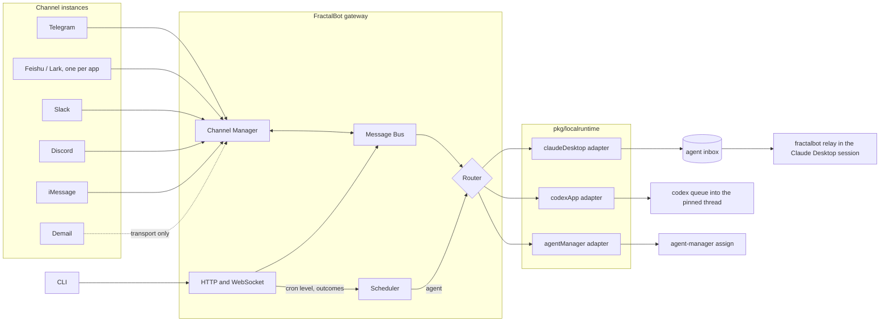

# Architecture

FractalBot is a local-first messaging gateway between people and agents.

1. Channel adapters normalize inbound messages.
2. A buffered in-process bus decouples transport from routing.
3. The router picks the receiving agent among those bound to the channel and delivers through that agent's runtime.
4. Schedules wake agents along the same path.

## System overview

## Components

| Component | Responsibility |
| --- | --- |
| `internal/configv2` | Loads and validates the version 2 configuration, derives data paths, produces the `config check` report. |
| `internal/secrets` | Resolves `secret:<name>` references from the machine's store and masks values and token shapes in output. |
| Channel Manager | Starts each configured channel instance with its resolved secrets, isolates their lifecycles, and sends outbound messages through per-channel workers. An instance missing a secret stays stopped and is reported. |
| Message Bus | Buffers inbound and outbound work while keeping the channels' synchronous reply contract. |
| `internal/router` | Identifies the channel instance and picks the agent (mention, pinned chat, `/use`, default). It also answers `/use` and `/who`, builds the prompt and delivers it. It handles schedule wakeups the same way, and records each agent's last delivery. |
| `pkg/localruntime` | One adapter contract (`Deliver`, `Presence`, `Capabilities`) for Claude Desktop, Codex App and agent-manager. It also owns the inbox protocol and the relay. It is an application-layer library with no FractalBot configuration dependency. |
| Scheduler (`internal/heartbeat`) | Computes cron runs per time zone, persists backoff levels and outcomes, and dispatches wakeups to agents. |
| Gateway server | `/health`, `/status` (by agent and channel), `/ws`, the message send API and the schedule APIs, all on loopback by default. |

Demail is a bidirectional transport adapter. Its inbound mail is agent-to-agent traffic and is not routed to agents.

## Inbound flow

1. A channel instance receives a provider event and applies its allowlist. Explicit `/agent` and `/to` selections are checked against the agents bound to the instance.
2. The adapter converts the event to a protocol message and publishes it through the Message Bus.
3. The router drops redeliveries, answers `/use` and `/who`, and picks the receiving agent. It wraps long bodies in a file and acknowledges on the channel.
4. The agent's runtime adapter delivers the prompt.
   - **Claude Desktop:** an envelope in the agent's inbox, which its relay moves into the session.
   - **Codex App:** `codex queue` into the pinned thread.
   - **agent-manager:** `assign`.
5. A delivered message restores the agent's schedules that set `resetOnInbound`.

## Outbound flow

The CLI calls the gateway's send endpoint, and the Message Bus sends through the named channel's worker.

- **Shared channels:** `--agent` prefixes the text with the agent's name.
- **Feishu:** `--receiver-id` selects the bot that received the message.

## Schedule flow

The scheduler sends each due job to the router as an autonomous wakeup carrying job, run, schedule and expiry metadata. It never synthesizes a chat identity.

- **Claude Desktop inboxes** coalesce waiting wakeups per job.
- **Codex and generic agent-manager delivery** report acceptance, not completion. `mode: heartbeatRun` waits for agent-manager's terminal outcome.
- **Agents report outcomes,** and may lower their own frequency within the configured `backoff` levels.

See [Schedules](heartbeat.md).

## Reliability and security boundaries

- Channel lifecycles are isolated, so one adapter stopping or panicking does not cancel the others.
- Channel allowlists default to deny where supported.
- A channel reaches only the agents bound to it. FractalBot never forwards to an unconfigured agent or another host.
- The configuration holds no secret values.
  - Resolved secrets live only in memory and are masked in logs and API errors.
  - `config check` reports whether each secret is set, never its value.
- Inboxes are owner-only, written atomically and consumed by one relay at a time.
- The relay only talks to a Claude Desktop messaging socket owned by the current user.
- The schedule and send APIs accept loopback requests only. WebSocket origins can be restricted with `gateway.allowedOrigins`.

See [Configuration](config-v2.md) and [Routing](routing.md).
