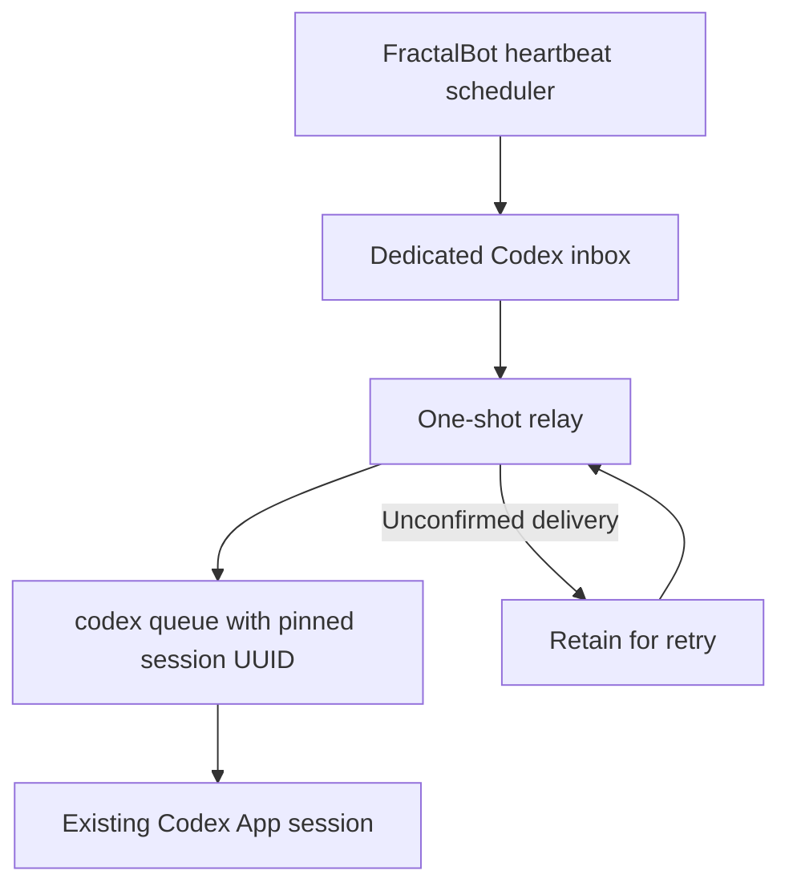

# Deliver to a pinned Codex session through its native queue

The optional Python helpers connect FractalBot to an existing Codex App session
using `codex queue --thread <UUID> --message <text>`. Incoming messages retain the
full Task Assignment prompt, including channel, chat, and receiving-bot context.
An active session queues the message behind its current turn.

The bridge uses the existing `ohMyCode.agentManagerScript` interface for messages
and the `codexAppCDP` durable inbox for heartbeats. It does not add a new Go
runtime, launch an Agent, start a second App server, or change the App lifecycle.
The `codexAppCDP` configuration name is historical here: no CDP endpoint is used.

## Requirements and installation

FractalBot is maintained in this monorepo's `runtime/fractalbot` subtree.
Run the installation examples below from that directory (`cd runtime/fractalbot`
from the repository root).

- A local Codex version with `codex queue` (`codex queue --help` must succeed).
- An existing local session UUID and its absolute project working directory.
- Python 3.9 or newer. The heartbeat relay uses POSIX file locking (macOS/Linux).
- A private, user-owned inbox and binding file; both helpers run as that user.

Copy both helpers into the project workspace. FractalBot requires the configured
agent-manager script to be inside that workspace:

```sh
project_dir=/absolute/path/to/project
mkdir -p "$project_dir/scripts"
cp scripts/codex_queue_route.py scripts/codex_queue_relay.py "$project_dir/scripts/"
mkdir -p ~/.config/fractalbot
cp examples/codex-queue/binding.example.json ~/.config/fractalbot/codex-queue.json
chmod 600 ~/.config/fractalbot/codex-queue.json
```

Edit the binding with your own session UUID, workspace, absolute Codex executable
path, agent, and heartbeat job allowlist. `FRACTALBOT_CODEX_QUEUE_CONFIG` overrides
the default binding path for both helpers. The UUID pins a single session;
changing the foreground App conversation does not redirect messages. Archive or
replacement of that session requires updating the binding.

Apply the `agents` fragment in
[`examples/codex-queue/agents.example.yaml`](../examples/codex-queue/agents.example.yaml)
to your private gateway configuration, replacing all placeholder paths. Keep
your existing channel credentials, heartbeat instruction, cron, profile override,
and scheduler state file. Restart the gateway using your existing supervisor.

The example uses a channel-scoped receiver target under
`agents.ohMyCode.targets.project`. Set its `receiverId` to the intended bot's ID,
and merge that target into your existing mapping. Leave other receiver targets
and any global fallback unchanged. Only the selected receiver uses this bridge.

The adapter supports `assign AGENT` only. `ohMyCode` lifecycle and monitor
commands are not mapped to Codex by this helper. A successful assignment means
the CLI confirmed queue acceptance in the configured session, not task completion.

A scheduled job can use the same adapter: give an `ohMyCode` heartbeat job
`target: project` (see [heartbeat.md](heartbeat.md)). It is delivered through
`assign` like an inbound message.

## Heartbeat relay



The `codexAppCDP` runtime must be enabled with an `inboxPath`, an empty or omitted
`cdpEndpoint`, `repairPolicy: off`, and `watch.enabled: false`. Heartbeat jobs
select `runtime: codexAppCDP`; no receiver `target` is needed. Only job IDs listed
in the binding's `heartbeat_jobs`, for its configured agent, are consumed.

Run the relay once to check configuration:

```sh
cd /absolute/path/to/project
python3 scripts/codex_queue_relay.py
```

The default relay root is `~/.fractalbot/codex-queue`; `--root` overrides it.
Its `inbox` subdirectory must exactly match the gateway's `inboxPath`. Each run
claims pending envelopes into `processing`, holds an exclusive lock, checks
the allowlist and expiry, then submits to the native queue. Failed submissions
remain in `processing` for a later retry; accepted envelopes go to `done`;
expired and malformed envelopes go to `expired` and `rejected`. An accepted
job/run pair with a recorded `done` receipt is not resubmitted.

Claiming files before submission protects a newer coalesced heartbeat from being
lost when an older run is archived. A newer unconsumed file in the inbox can
still replace its predecessor, as documented in [Heartbeat delivery](heartbeat.md).
The relay preserves job ID, run ID, scheduled time, expiry, and the autonomous
wakeup instruction. It checks expiry before queueing; waiting in the Codex queue
may outlast expiry, so the receiving Agent should also check `expires_at`.

Delivery is **not exactly once**. A crash or timeout after native acceptance but
before recording `done` can cause a duplicate on retry. Do not use queue
acceptance as a business-completion acknowledgement or assume duplicate delivery
makes an irreversible task safe to repeat. CLI output and logs never echo the
message body or raw CLI stderr.

On macOS, copy and customize
[`examples/codex-queue/relay.launchagent.plist`](../examples/codex-queue/relay.launchagent.plist)
into `~/Library/LaunchAgents/ai.fractalmind.codex-queue-relay.plist`. Replace every
`/absolute/path` and `/Users/you` placeholder. The example watches the inbox,
runs at login, and retries every 30 seconds. This is a transport retry interval;
FractalBot remains the sole heartbeat scheduler. Do not add another heartbeat
automation or cron job.

```sh
mkdir -p ~/.fractalbot/codex-queue/inbox ~/.fractalbot/codex-queue/logs
chmod 700 ~/.fractalbot/codex-queue ~/.fractalbot/codex-queue/inbox ~/.fractalbot/codex-queue/logs
launchctl bootstrap "gui/$(id -u)" ~/Library/LaunchAgents/ai.fractalmind.codex-queue-relay.plist
```

Keep the relay and Codex under the same OS user. On Linux, an existing supervisor
can invoke the one-shot relay when the inbox changes and periodically retry it.
Old `done`, `expired`, and `rejected` archives are local operational records;
apply your own retention policy to them.

## Replies and verification

The App's final answer is not automatically mirrored to the originating chat.
The Agent replies through FractalBot using the preserved channel and chat ID;
multi-bot Feishu replies also need the original `receiver_id`.

Verify with one real incoming message and its reply in the original chat. For
heartbeats, verify scheduler inbox acceptance, relay archival, and actual arrival
in the pinned session separately. The gateway's `queued` status confirms only
its inbox stage. The helper tests use a fake Codex executable and no credentials:

```sh
PYTHONDONTWRITEBYTECODE=1 python3 -m unittest discover -s scripts/tests -v
```

From the monorepo root, run `make test-python MODULE=runtime/fractalbot`.
The FractalBot Go CI job runs this same target after its build, vet, and Go tests.
